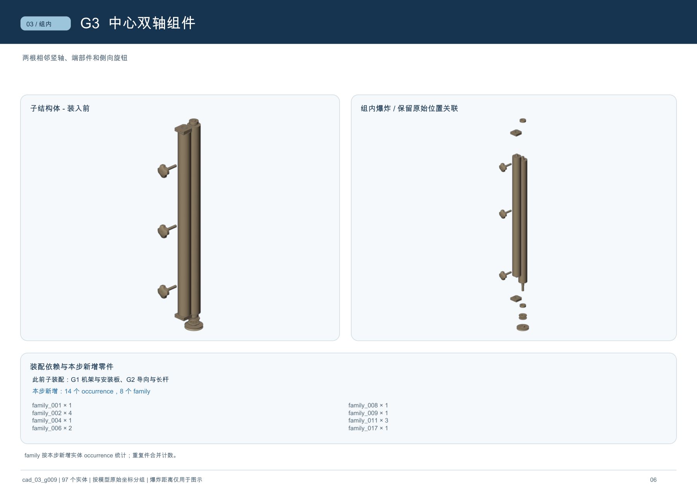
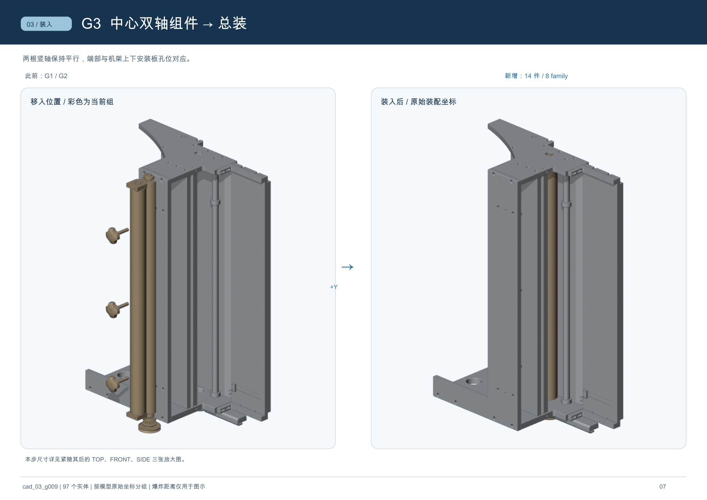

# cad_03_g009 分层装配示例

以下两张图来自 [示例题包的 assembly.pdf](../../example_harbor/cad_03_g009/environment/input/assembly.pdf) 第 8、9 页，使用同一份 STEP 的子装配计划和渲染缓存生成。

G3 页将本组原位与组内爆炸图并列，并统计本步新增的 family 和 occurrence。展开距离用于展示层次，不表示拆卸行程。

装入页将此前组作为灰色背景，把新增组着色，比较示意移入位置与最终安装位置。换模型时须重新判断分组、展开方向和遮挡，不能照搬此例的零件 ID 或位移。
